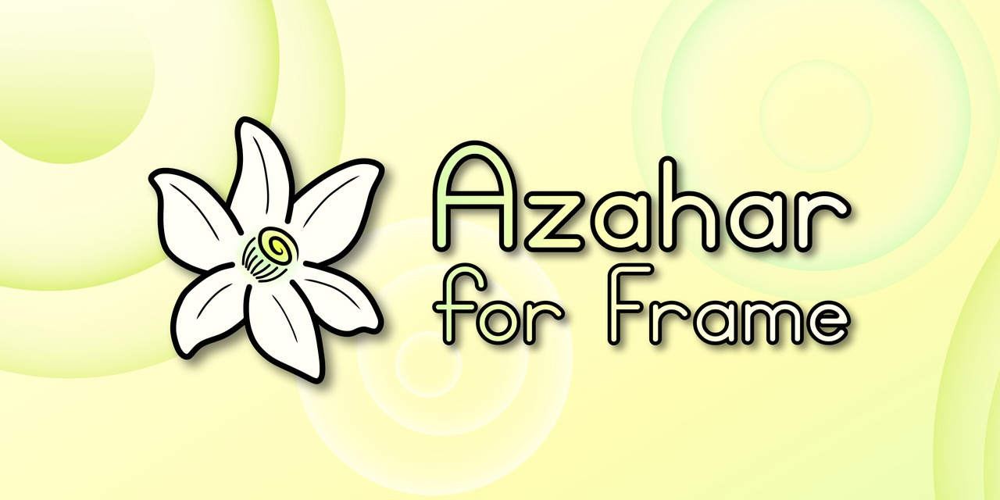

# Azahar for Frame

Nintendo 3DS games in VR, running natively on the Valve Steam Frame.
It is the [Azahar](https://github.com/azahar-emu/azahar) emulator with the VR mode from amwatson's [CitraVR](https://github.com/amwatson/CitraVR).



The emulator runs on the Frame itself, inside SteamVR. Azahar draws the 3DS screens with Vulkan straight into SteamVR, so nothing is streamed from a PC. You supply your own games.

## Status

I build it from source on the Frame. The first release is not out yet, and the install steps below are written for it.
The parts that depend on the VR code are checked against the finished build before it is published.

<!-- VERIFY: everything below that depends on the XR code is checked against the finished build before publishing. -->

Known issues:

- Immersive mode only has settings for Ocarina of Time 3D and Majora's Mask 3D. It is experimental.
- The 3D depth is set to 50 % when it is 0, so the top screen is always stereoscopic in VR.

<!-- VERIFY: both items -->

The changes are listed in [docs/CHANGELOG.md](docs/CHANGELOG.md).

## What this adds

Compared with CitraVR on the Quest:

- It runs as a Linux program on the Frame. There is no Lepton, APK, adb or PC.
- It draws with Vulkan into SteamVR through OpenXR.
- It uses the Steam Frame controllers, with the real D-pad where CitraVR needed a trick.
- Azahar's own window is in VR, with the game list, menus and settings, and the laser is the mouse.
- Holding **Menu** pauses the game and opens that window over it.
- Immersive mode runs on SteamVR.

Compared with Azahar on a PC:

- There is a stereoscopic 3D top screen and a bottom touch screen, floating in front of you.
- You aim at the screens with a controller.
- The 3D depth starts at 50 %, where Azahar's own default is 0.

## Requirements

- A Steam Frame with SteamOS and SteamVR, and about 500 MB free, plus your games
- Your own 3DS games, dumped from your own console. Decrypted dumps need nothing else. Encrypted ones need the keys from the same console (see [Games](#games))
- A terminal on the Frame: SSH, or Konsole (SteamVR dashboard, Launch a program, Desktop)
- Steam running while you install

## Install

1. Get the repository:

   ```sh
   git clone -b steam-frame https://github.com/simplysanatori/AzaharFrame.git
   cd AzaharFrame
   ```

2. Download `azaharframe-1.0.0-linux-arm64.tar.gz` and `SHA256SUMS` from [Releases](https://github.com/simplysanatori/AzaharFrame/releases). Check and install:

   ```sh
   sha256sum -c --ignore-missing SHA256SUMS
   steam-frame/install.sh ~/Downloads/azaharframe-1.0.0-linux-arm64.tar.gz
   ```

3. Launch **Azahar for Frame** from your Steam library.

The installer adds the library entry with its artwork and icon, gives SteamVR's dock the name and icon, and sets SteamVR to 120 Hz for it. `install.sh --dry-run` lists every file it would copy and every Steam and SteamVR call, and changes nothing. It never asks a question, and if Steam is not running it installs the files and says the library entry was skipped; run it again with Steam up.

You can also install with [Frametanium](https://github.com/Cogential/frametanium): add `simplysanatori/AzaharFrame` and it runs the same `install.sh`.

### Update

Download the new tarball and install it, or update from Frametanium. Your settings, saves and keys stay, and the same library entry is updated. Quit the emulator first.

```sh
steam-frame/install.sh ~/Downloads/azaharframe-<version>-linux-arm64.tar.gz
```

### Uninstall

Quit the emulator first. This removes the library entry, the program folder and the dock icon files. Add `--purge` to also delete your settings, saves, keys and shader caches. Your games are never touched. Removing it from Frametanium does the same without `--purge`.

```sh
steam-frame/uninstall.sh
```

## First run

The game list is empty the first time.

1. Azahar's window floats in front of you. Point at the empty game list and double-click it with the trigger (or **A**).
2. Select your game folder.
3. Double-click a game to start it.

<!-- VERIFY: steps 1 to 3 -->

### Games

Put your games in `~/Documents/Roms/3ds/`, or any folder you like. It plays `.3ds`, `.cci`, `.cxi`, `.app` and `.3dsx` files, and the compressed `.zcci`, `.zcxi` and `.z3dsx` ones. A `.cia` is installed first, from **File > Install CIA...** in the Azahar window; it then appears in the game list with your other games.

- Decrypted dumps work as they are.
- Encrypted dumps need `aes_keys.txt` from your own console in `~/.local/share/AzaharFrame/user/sysdata/`.

### Texture packs and mods

Custom textures and game mods go in the data folder, in a folder named for the game's title ID (the 16 characters shown in the emulator's log, for example `0004000000033500`):

- `~/.local/share/AzaharFrame/user/load/textures/<TitleID>/` for texture packs (the pack's `pack.json` goes directly in that folder).
- `~/.local/share/AzaharFrame/user/load/mods/<TitleID>/` for mods (a `romfs/` folder, `exheader.bin` or `code.ips`).

Custom textures are on from the first launch, and they load in the background while you play, so a new area can show the original textures for a moment. If you already have your own settings file, turn on **Emulation > Configure > Graphics > Advanced > Use custom textures** yourself.

#### Optimize Texture Pack for Frame

HD packs are PNG files, and the emulator decodes each one the first time the game uses it. A 4096×4096 texture takes over a second, which is why a new area shows the low-resolution textures first. So I added a converter: in the Azahar window, right-click the game and choose **Optimize Texture Pack for Frame...**. It writes a copy of the pack in ASTC, the compressed format the Frame's GPU reads as it is, with every mip level made in advance. Those files are read in a few milliseconds instead of being decoded, and they take a quarter of the GPU memory.

- The original pack is not changed. The copy goes next to it (`<TitleID>-astc4x4`), and the game's folder in `load/textures/` becomes a link to the copy. **Use Original Texture Pack** in the same menu switches back. To remove the copy, delete its folder.
- The first time, it builds its encoder (ARM's astcenc), which takes about two minutes and needs git, CMake and a C++ compiler.
- **Stop** is safe. Choose the menu entry again and it carries on where it left off. It runs at the lowest priority, but it is still best not to run it while you play.
- Ocarina of Time 3D with Henriko Magnifico's 4K pack: 2308 textures, 4.5 GB as PNG. As ASTC 4x4 it is about 6.0 GB, and about 2.7 GB with `--block 6x6`. Decoded, the PNGs would be 18 GB of memory; the emulator now keeps an ASTC texture in memory only until the GPU has it.

From a terminal, with more options (`--block 6x6` for a pack half the size, `--quality thorough`, `--jobs`):

```sh
~/Games/AzaharFrame/app/tools/convert-texture-pack.sh --activate ~/.local/share/AzaharFrame/user/load/textures/<TitleID>
~/Games/AzaharFrame/app/tools/convert-texture-pack.sh --restore ~/.local/share/AzaharFrame/user/load/textures/<TitleID>
```

<!-- VERIFY: conversion time for the OoT3D pack, and the sizes, once measured -->

Packs that already ship DDS or KTX files work too, with or without `skip_mipmap`, and their mip levels are used as stored.

## Controls

| Steam Frame | 3DS |
|---|---|
| Left stick | Circle Pad |
| Right stick | C-Stick |
| Left D-pad | D-pad |
| **A** (bottom), **B** (right), **X** (left), **Y** (top) | B, A, Y, X, by position as on the 3DS |
| Left and right bumper | L and R |
| Left and right trigger | ZL and ZR |
| Trigger aimed at the bottom screen | Touch. Hold and move to drag |
| Grip aimed at a screen | Move the screens. The stick of that hand moves them nearer and farther |
| **Menu** (right controller) | Start. Hold for 1 second to pause and open the in-game menu |
| **View** (left controller) | Select. Hold for 1.5 seconds to stop the game |
| Left stick click | Home |
| Right stick click | Reset the screen positions |
| Both bumpers + **View** | Show or hide the bottom screen, in games that hide it |
| Both bumpers + **View** + **Menu** | Switch between VR and Flat (Azahar's window on the Frame's screen) |

On Azahar's window and in the in-game menu:

| Frame | Window |
|---|---|
| Trigger or **A** | Left click |
| Right stick click | Right click. Hold for 1 second to bring the window back in front of you |
| **B** | Back. In the in-game menu with nothing open, back to the game |
| Grip | Move the window |
| Stick up and down | Scroll |

The right controller is also the 3DS's motion sensor, for games that aim by moving the 3DS. Hold it like a 3DS with the beam pointing into the screen.

All controls: [docs/CONTROLS.md](docs/CONTROLS.md).

<!-- VERIFY: the table in the headset. It matches src/frame_xr/input/MAPPING.md. -->

### Playing in a window (Flat)

I wanted to be able to play a 3DS game in a window as well, like any other flat game on the Frame, with other apps open beside it, instead of loading the app and having black all around me. So the same library entry starts in one of two modes: VR, as above, or Flat, which is Azahar's normal window on the headset's virtual screen. It starts in the mode you used last, and VR the first time. Press both bumpers, **View** and **Menu** together to switch between them while it runs; [docs/CONTROLS.md](docs/CONTROLS.md#playing-in-a-window-flat) says how to start in Flat once.

Both modes use the same data folder, so your games, saves, mods, textures and settings are the same. In Flat, Azahar is not forced to full screen, so it stays in its window. The Frame controllers come through Steam Input as a gamepad and are mapped by position, like the 3DS, in their own controls profile, **Flat Gamepad**, so your VR controls are left alone. The mouse is the touch screen. 3D follows Azahar's own 3D setting.

## Settings

Everything is in the Azahar window on the SteamVR dashboard, under **Emulation > Configure**. Resolution, filters, controls and audio are the ones you know from Azahar.
Per-game settings work as in Azahar: right-click a game in the list and choose **Properties**.

The first time VR starts, the buttons and sticks of the current controls profile are replaced with the Frame layout (**Emulation > Configure > Controls**). After that your changes stay. In VR the Single Screen and Separate Windows layouts are changed to Default, and the 3D depth is set to 50 % if it is 0.

### Face Buttons and Motion Controls

In the **VR** group of the Graphics tab (global settings, not per game):

- **Face Buttons**: **By Position (Nintendo)** (default) makes the Frame's A, B, X and Y do what the 3DS button in the same place does. **By Label (Xbox)** makes A, B, X and Y the 3DS's A, B, X and Y.
- **Motion Controls**: **Off**, **Right Controller** (default) or **Left Controller**. The controller becomes the 3DS's gyroscope and accelerometer, for games like Ocarina of Time 3D that aim the first-person items by moving the 3DS.

<!-- VERIFY: motion axes and speed in the headset -->

### Immersive mode

Normally the top screen floats two metres away. In immersive mode the game draws a wider view, and in the Full modes its camera follows your head.
Turn it on in the game's properties, on the **Graphics** tab, in the **VR** group, under **Immersive Mode**:

- **Wide (3DoF):** a big screen fixed in the room.
- **Full (6DoF): Ocarina of Time, Majora's Mask:** the screen stays in front of your eyes and the game camera turns and moves with your head.
- **Full (6DoF): Other Games:** the same, for games the other mode does not fit; it finds the camera while you play.

The **Immersive Game FOV** setting next to it is the game camera's vertical angle in degrees (60 by default). Change it only if a mod changes the game's FOV. Only Ocarina of Time 3D and Majora's Mask 3D have the settings it needs. Both bumpers and **View** show or hide the bottom screen, and the right stick click re-centres the view. [src/frame_xr/IMMERSIVE.md](src/frame_xr/IMMERSIVE.md) has the details and the tuning variables.

<!-- VERIFY: the whole section -->

### Hide Bottom Screen

Some games do not need the bottom screen. In a game's properties, on the **Graphics** tab, in the **VR** group, tick **Hide Bottom Screen** to show only the top screen. Hold both bumpers and press **View** to bring the bottom screen back, and again to hide it. The setting is read when the game starts. [docs/CONTROLS.md](docs/CONTROLS.md) lists the controls for Ocarina of Time 3D with the Ocarina ReFramed single-screen mod, and the settings I use with Single Screen Experience.

### Screen Shape

Some mods draw the top screen widescreen, squeezed into the 3DS's 5:3 picture. In a game's properties, on the **Graphics** tab, in the **VR** group, set **Screen Shape** to **Widescreen (16:9)** or **Ultrawide (21:9)** to stretch the top screen in VR to match. It keeps its height and gets wider, and the bottom screen stays where it was. It is also the shape of the screen in immersive mode. The setting is read when the game starts, and it has to agree with the mod's own aspect option.

## Performance

The 3DS runs at 60 frames a second, and every one is shown on each refresh of the headset.
The first time a game draws a new effect, the emulator compiles its shaders and the picture can hitch. They are kept in `~/.local/share/AzaharFrame/user/shaders`, so it happens once.
If a game drops frames, lower the internal resolution under **Emulation > Configure > Graphics**.
Keep other heavy work off the Frame while you play.

## Files

| What | Where |
|---|---|
| Program and launcher | `~/Games/AzaharFrame/app` |
| Steam library art and icons | `~/Games/AzaharFrame/app/art` |
| Dock icon files | `~/.local/share/applications/azaharframe.desktop`, `azaharframe.png` and `azahar.png` in `~/.local/share/icons/hicolor`, `azaharframe.vrmanifest` in the program folder |
| Icon cache of the old VR picker (`AZAHARFRAME_VR_PICKER=1`) | `~/.cache/azaharframe/icons` |
| Settings, saves, keys, shader caches | `~/.local/share/AzaharFrame/user` |
| Launcher log | `~/.local/share/AzaharFrame/launch.log` |
| Emulator log | `~/.local/share/AzaharFrame/user/log/azahar_log.txt` |
| Settings for one launch | `~/.local/share/AzaharFrame/session.env` |
| Mode it starts in (`vr` or `flat`) | `~/.local/share/AzaharFrame/mode` |
| Texture pack encoder (built on first use) | `~/.local/share/AzaharFrame/tools` |

How the port works: [docs/TECHNICAL.md](docs/TECHNICAL.md).

## Troubleshooting

- **Steam's debugging port is not reachable.** Start Steam and run `install.sh` again.
- **SteamVR's dock shows a question mark instead of the flower.** Steam reads the icon when it starts. Restart Steam once.
- **The screens do not appear in the headset.** Start SteamVR first, then Azahar for Frame. `launch.log` says which OpenXR runtime it found, and the emulator log says `running flat` when it could not start VR.
- **A game in a subfolder is not in the list.** Right-click the game folder in the list (right stick click) and tick **Scan Subfolders**.
- **The Azahar window is too small on the dashboard.** Add `QT_SCALE_FACTOR=1.25` to `session.env`.
- **An encrypted game does not start.** It needs `aes_keys.txt` in `user/sysdata/`.
- **Motion ghosts.** In SteamVR, check 120 Hz and motion smoothing off.

<!-- VERIFY: each entry -->

## Reporting a problem

Attach `launch.log` and `user/log/azahar_log.txt` from `~/.local/share/AzaharFrame` to an [issue](https://github.com/simplysanatori/AzaharFrame/issues).
They hold the paths of your games, which include your user name, the names of the games you started, your computer's processor, graphics card and system version, your headset's name, and the settings you use. They hold no network addresses. Read them before sharing and replace anything you want to keep private.
If the same thing happens in Azahar on a PC, report it to [Azahar](https://github.com/azahar-emu/azahar/issues) instead.

## Build from source

On the Frame, with a C++ compiler, CMake 3.24 or newer, Ninja, the Qt 6 and SDL2 development files and Python 3:

```sh
steam-frame/build.sh 1.0.0
steam-frame/install.sh
```

The first build takes about an hour and loads every core. It waits while the headset is in use. `build.sh` packs `steam-frame/release/azaharframe-1.0.0-linux-arm64.tar.gz` and `SHA256SUMS`, and `install.sh` installs that tarball. The options are in [docs/TECHNICAL_NOTES.md](docs/TECHNICAL_NOTES.md#building).

## Support

Support upstream first: star [CitraVR](https://github.com/amwatson/CitraVR) and [Azahar](https://github.com/azahar-emu/azahar). Azahar for Frame's changes are not offered to them.
If you find a bug that also happens in Azahar on a PC, report it to [Azahar](https://github.com/azahar-emu/azahar/issues).
If you would like more Steam Frame ports, you can also [buy me a coffee](https://ko-fi.com/sana748653).

## Credits

- [CitraVR](https://github.com/amwatson/CitraVR) by amwatson: the VR port this is built on
- [Azahar](https://github.com/azahar-emu/azahar) and [Citra](https://github.com/citra-emu/citra): the emulator
- The Azahar logo is by angyartanddraw and PabloMK7 (CC BY 4.0). The artwork backgrounds are SteamGridDB uploads by GarfieldGaming0624
- Valve: SteamVR and the Frame

Full list: [THIRD_PARTY_NOTICES.md](THIRD_PARTY_NOTICES.md). Artwork sources: [steam-frame/art/CREDITS.md](steam-frame/art/CREDITS.md). CitraVR's README: [README.upstream.md](README.upstream.md). Unofficial fan project, not affiliated with Nintendo, Valve, the Azahar team or the CitraVR author. Nintendo 3DS is a trademark of Nintendo.

## Licence

GPLv3 or any later version, same as upstream. See [LICENSE.txt](LICENSE.txt). Third-party parts keep their own licences.

## How this was made

I made this with partial assistance from Claude.
