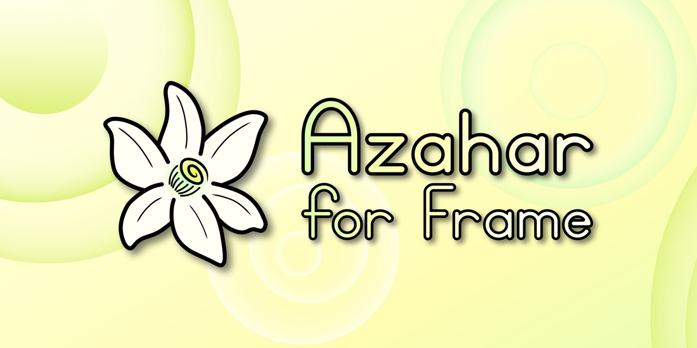
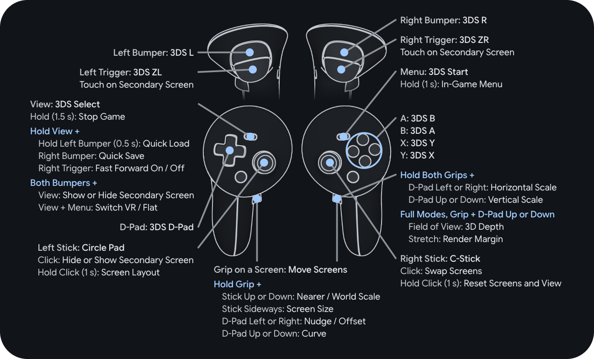

# Azahar for Frame

Nintendo 3DS games in VR, running natively on the Valve Steam Frame.
It is my unofficial fork of [Azahar](https://github.com/azahar-emu/azahar), with the VR modes of amwatson's [CitraVR](https://github.com/amwatson/CitraVR).



## Features

- Stereoscopic 3D at 90 or 120 Hz, with a touch Secondary Screen
- Switch between VR and Flat mid-game
- Immersive 3D modes with Natural 3D, matched to your IPD
- Tuned presets for Zelda and Mario games
- A redesigned in-game menu with save states and autosave
- Cheats, mods, texture packs and homebrew, downloaded in the headset
- Edit the controls of any gamepad or mouse

## 3D and immersion

- **VR or Flat, any time**: press both bumpers, **View** and **Menu** together. The game keeps running.
- **Immersive Mode**: the game draws a wider view. **Wide (3DoF)** is a big screen fixed in the room. In **Full (6DoF)**, the game camera turns and moves with your head.
- **Natural 3D**: the Full modes draw the game true to scale, from your IPD as the Steam Frame measures it. At 100% **3D Depth**, distant scenery sits at infinity.
- **World Scale**: how big the game world feels, from 10% to 400%. Hold a grip and push the stick up or down.
- **Presets**: The Legend of Zelda: Ocarina of Time 3D, Majora's Mask 3D, Super Mario 3D Land and Mario Kart 7 start with settings tuned for the Frame. A value you set yourself always wins.

## The in-game menu

Hold **Menu** for 1 second to open the completely redesigned in-game menu. Settings can be for one game or for all.

The **Mods** tab downloads, in the headset:

- **Cheats**: from [Sharkive](https://github.com/FlagBrew/Sharkive) and my [3ds-game-fixes](https://github.com/simplysanatori/3ds-game-fixes)
- **Mods** and **Textures**: from their creators' own uploads on GameBanana, GitHub, MEGA and Google Drive

Nothing is hosted by this project. The app only fetches files from their original sources, and each entry links to its creator's page. A **Verified** chip marks entries known to work on Azahar for Frame. A check-mark badge marks my **Recommended** picks.

## Homebrew and CTGP-7

- **Homebrew** (beta): the first entry is [Emerald 3DS](https://github.com/ZallaxDev/emerald-3ds) by ZallaxDev. It downloads from its GitHub and builds from your own Pokémon Emerald ROM.
- **CTGP-7**: with Mario Kart 7 open, the **Mods** tab installs [CTGP-7](https://ctgp-7.github.io/) by PabloMK7 and the CTGP-7 team. It downloads only from the official CTGP-7 page. Nothing of CTGP-7 is included or redistributed.

## Game fixes

- **Accurate Image Copies** (**Settings** > **Graphics**) fixes the shimmering glow in Fire Emblem Echoes and Fates at a raised resolution. Its default, **Automatic**, applies it only where a game needs it.
- **Angel's Aim** (alpha) is a direct-aim, light-gun-style mode for Kid Icarus: Uprising. Its mod is in the [3ds-game-fixes](https://github.com/simplysanatori/3ds-game-fixes) catalogue; full write-up in the [user guide](docs/USER_GUIDE.md#angels-aim-kid-icarus-uprising).

## Experimental

- **Black Frame Insertion**: a clearer picture when you turn your head. It may flicker.
- **Detach Screens**: move the Primary and Secondary Screens apart, each anywhere around you.

## How it works

The emulator runs on the Frame itself and draws both eyes through SteamVR.
You bring your own games. Nothing is streamed from a PC.
Downloads happen only when you ask for them.

## Requirements

- A Steam Frame with SteamOS and SteamVR, and about 500 MB free
- SteamOS Stable, Beta or Preview
- Your own 3DS games, dumped from your own console
- A terminal on the Frame: SSH, or Konsole
- Steam running while you install

## Install

1. Get the repository:

   ```sh
   git clone -b steam-frame https://github.com/simplysanatori/AzaharFrame.git
   cd AzaharFrame
   ```

2. Download `azaharframe-1.2.0-linux-arm64.tar.gz` from [Releases](https://github.com/simplysanatori/AzaharFrame/releases) and install it:

   ```sh
   steam-frame/install.sh ~/Downloads/azaharframe-1.2.0-linux-arm64.tar.gz
   ```

3. Launch **Azahar for Frame** from your Steam library.

Other installers:

- [Frametanium](https://github.com/Cogential/frametanium): add `simplysanatori/AzaharFrame`.
- [FrameDrop](https://framedropvr.com): [Install with FrameDrop](https://framedropvr.com/install?manifest=https%3A%2F%2Fgithub.com%2Fsimplysanatori%2FAzaharFrame%2Freleases%2Flatest%2Fdownload%2Fazaharframe.framedrop.json).

Checksums and building: [user guide](docs/USER_GUIDE.md#install-update-and-uninstall).

## First run

1. Double-click the empty game list and select the folder with your games.
2. Double-click a game to start it.

Keys and texture packs: [user guide](docs/USER_GUIDE.md#games).

## Controls



| Steam Frame | What it does |
|---|---|
| **A**, **B**, **X**, **Y** | 3DS B, A, Y, X (by position) |
| Hold **Menu** for 1 second | In-game menu |
| Hold **View** for 1.5 seconds | Stop the game |
| Hold **View**, then right or left bumper | Quick Save or Quick Load |
| Hold **View**, then right trigger | Fast Forward on or off |
| Both bumpers + **View** + **Menu** | Switch between VR and Flat |
| Trigger on the Secondary Screen | Touch |

To change them, use **Edit Controls** on the in-game menu's **Controls** tab. Full list: [docs/CONTROLS.md](docs/CONTROLS.md).

## Update

Quit the emulator, then install the new tarball.

```sh
steam-frame/install.sh ~/Downloads/azaharframe-<version>-linux-arm64.tar.gz
```

## Uninstall

Add `--purge` to also delete your settings, saves and keys. Your games are never touched.

```sh
steam-frame/uninstall.sh
```

## Troubleshooting

- The installer says Steam was not reachable: start Steam and run `install.sh` again.
- The SteamVR dock shows a question mark: restart Steam once.
- The screens do not appear: start SteamVR first, then Azahar for Frame.
- An encrypted game does not start: it needs `aes_keys.txt` in `~/.local/share/AzaharFrame/user/sysdata/`.
- **Azahar Ran Out of Memory**: turn off **Preload Custom Textures**, or use **Optimize for Frame** on the pack.

More: [docs/USER_GUIDE.md](docs/USER_GUIDE.md#troubleshooting).

## Reporting a problem

Use **Report a Problem**: **Settings** > **General** > **Help** in the in-game menu, or **Help** in Azahar's window.
**See What's Sent** shows the whole report. **Save Report** makes a zip in `~/Documents/AzaharFrame Reports` to attach to an [issue](https://github.com/simplysanatori/AzaharFrame/issues); check it before sharing. **Send Report** sends it to me. Nothing is sent unless you tap it.

## Roadmap (planned)

- **Full immersion mode**: a full 6DoF game experience.
- **Nintendo DS and DSi**: through [melonDS](https://github.com/melonDS-emu/melonDS) (GPLv3), with Vulkan renderer work from SapphireRhodonite's [WatermelonDS](https://github.com/SapphireRhodonite/WatermelonDS) and melonDS-android-lib.
- **Dual-screen GBA**: through kyannon's [gba-ds](https://github.com/kyannon/gba-ds), with the map or status screen on the Secondary Screen.

## More

- [User guide](docs/USER_GUIDE.md)
- [Settings](docs/SETTINGS.md)
- [AGENTS.md](AGENTS.md): for developers and AI agents
- [Building from source](docs/TECHNICAL_NOTES.md#building)
- [Changelog](docs/CHANGELOG.md)

## Support

CitraVR's author takes donations: [buy them a beer](https://www.buymeacoffee.com/fewerwrong).
If you would like more Steam Frame ports, you can also [buy me a coffee](https://ko-fi.com/sana748653).

## Credits

- [Azahar](https://github.com/azahar-emu/azahar), which continues [Citra](https://github.com/citra-emu/citra): the emulator
- [CitraVR](https://github.com/amwatson/CitraVR) by amwatson: the VR modes
- [Qt](https://www.qt.io), [SDL](https://www.libsdl.org), [OpenXR](https://www.khronos.org/openxr/): window, gamepad, VR
- [astcenc](https://github.com/ARM-software/astc-encoder) by Arm: the texture pack encoder
- [Frametop](https://github.com/Frametop/frametop) by DeeJanuz: the 3D mouse pointer is adapted from it
- [Sharkive](https://github.com/FlagBrew/Sharkive) by FlagBrew, and my [3ds-game-fixes](https://github.com/simplysanatori/3ds-game-fixes): the cheats
- [Emerald 3DS](https://github.com/ZallaxDev/emerald-3ds) by ZallaxDev, and [CTGP-7](https://ctgp-7.github.io/) by PabloMK7: downloaded from their own sources
- Mods and texture packs: downloaded from their authors' own pages
- Azahar logo by angyartanddraw and PabloMK7; backgrounds by GarfieldGaming0624 on [SteamGridDB](https://www.steamgriddb.com/game/5480678)
- Valve: SteamVR and the Frame

Full list: [THIRD_PARTY_NOTICES.md](THIRD_PARTY_NOTICES.md). Not affiliated with Nintendo or Valve.

## Licence

GPLv3 or any later version. See [LICENSE.txt](LICENSE.txt).

## How this was made

I started this project and used AI (Claude Opus 5.5) to speed up development. I write, review and fix code by hand all the way through, keep the AI's work checked and reined in, and aim to keep the port as lightweight as possible. I test it on my own Steam Frame.
